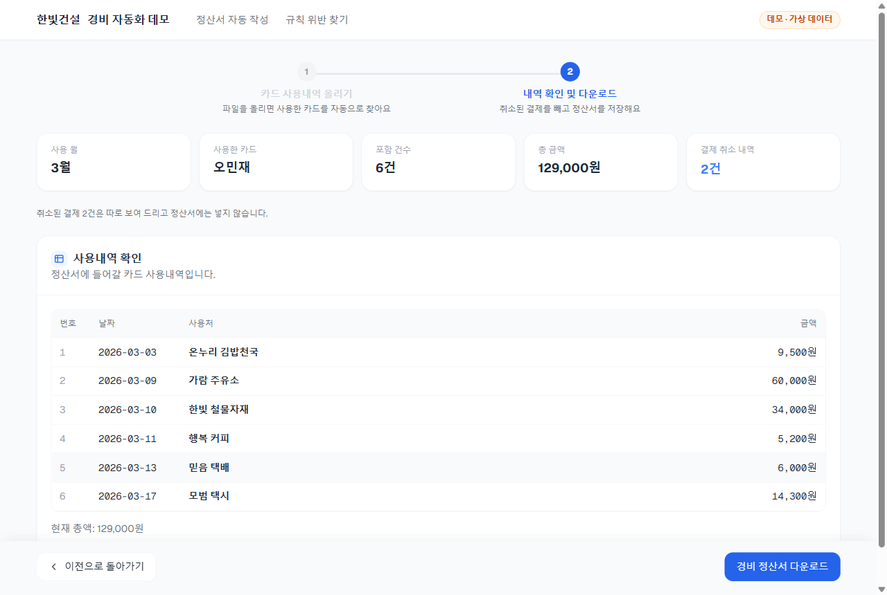
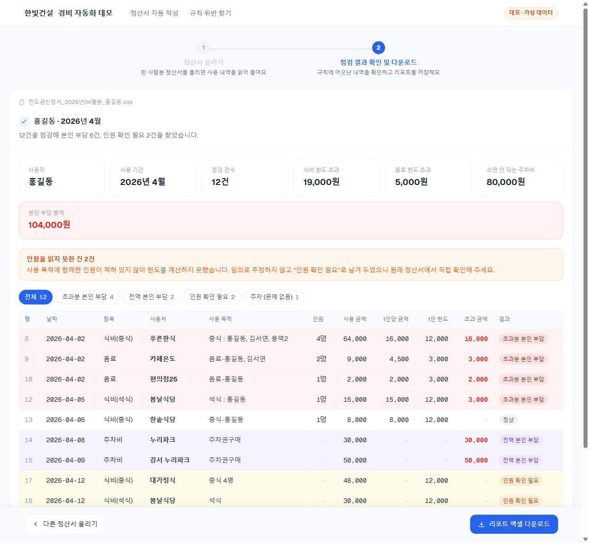

# 한빛건설 경비 자동화 데모

법인카드 경비 처리를 자동화하는 사내 시스템을, 가상 회사 "한빛건설"과 가상 데이터로 다시 만든 체험용 데모입니다.

**데모 사이트: https://hanbit-expense-demo.vercel.app**

> 회사명·인물·카드번호를 포함한 모든 데이터는 가상입니다. 실제 개인정보나 업무 데이터는 들어 있지 않습니다.

## 체험할 수 있는 것

| 화면 | 하는 일 |
|---|---|
| 정산서 자동 작성 | 카드사에서 받은 사용내역 엑셀을 올리면, 어떤 카드로 쓴 내역인지 찾고 취소된 결제를 뺀 뒤 경비 정산서(전도금 신청서) 엑셀을 만들어 줍니다. |
| 규칙 위반 찾기 | 작성한 정산서를 회사 경비 규칙과 비교해 식비·음료 한도 초과, 쓰면 안 되는 주차비, 인원이 적히지 않은 내역을 찾아 리포트 엑셀로 내려 줍니다. |

**정산서 자동 작성** — 카드 사용내역을 읽어 정산서에 들어갈 내역을 보여 주는 화면



**규칙 위반 찾기** — 정산서를 경비 규칙과 비교한 점검 결과 화면



각 화면에서 샘플 파일을 내려받아 그대로 올리면 결과까지 볼 수 있습니다. 규칙 위반 찾기에서는 한도를 바꿔 결과가 다시 계산되는 것도 확인할 수 있습니다.

## 특징

- **서버가 없습니다.** 정적 사이트이고, 엑셀 읽기·판정·생성이 모두 브라우저 안에서 이루어집니다. 올린 파일은 어디로도 전송되지 않습니다.
- **규칙은 코드 밖에 있습니다.** 한도와 금지 항목은 `src/lib/audit/expenseRules.json` 에서 관리합니다.
- **핵심 로직은 화면과 분리돼 있습니다.** `src/lib` 는 프레임워크에 의존하지 않아 node 로 바로 테스트합니다.

## 실행

```bash
npm install
npm run dev      # 개발 서버 (http://localhost:3000)
npm run build    # 정적 사이트 생성 → out/
```

## 테스트

```bash
npx tsc --noEmit

# 규칙 위반 찾기 로직 (파일별로 실행)
node scripts/audit/testSamples.mjs
node scripts/audit/testAudit.mjs
node scripts/audit/testNoteParser.mjs
node scripts/audit/testAuditReport.mjs
node scripts/audit/testExpenseLimits.mjs

# 정산서 자동 작성 로직
node --import ./scripts/advance/register.mjs --test scripts/advance/advance.test.mts
```

## 폴더 구조

```
src/app/            화면 (홈, demo/advance, demo/audit)
src/components/     공용 컴포넌트 (단계 표시, 파일 올리기, 알림, 창)
src/lib/advance/    카드 사용내역 읽기 → 정산서 엑셀 생성
src/lib/audit/      정산서 읽기 → 규칙 판정 → 리포트 엑셀 생성
public/samples/     화면에서 내려받는 샘플 2개와 정산서 양식
scripts/            테스트, 샘플 생성 스크립트, 테스트 전용 샘플(fixtures)
```

## 기술

Next.js (정적 export) · React · TypeScript · SheetJS · ExcelJS
